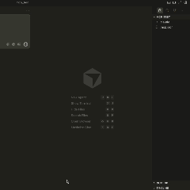

# Cursor History MCP

<p align="center">
  
</p>

[](https://www.npmjs.com/package/cursor-history-mcp)
[](https://www.npmjs.com/package/cursor-history-mcp)
[](https://opensource.org/licenses/MIT)
[](https://nodejs.org/)
[](https://www.typescriptlang.org/)

[](https://cursor.com/install-mcp?name=cursor-history&config=eyJjb21tYW5kIjoibnB4IiwiYXJncyI6WyIteSIsImN1cnNvci1oaXN0b3J5LW1jcCJdfQ==)

**用于浏览、搜索、导出和备份 Cursor AI 聊天记录的 MCP 服务器。**

将您的 Cursor AI 聊天记录直接接入 Claude。搜索历史对话、导出会话、创建备份、生成年度回顾报告——全部通过自然语言完成。基于 [Model Context Protocol](https://modelcontextprotocol.io/) 构建，实现无缝 AI 助手集成。

免费、开源，MIT 许可证。由社区构建，为社区服务。

## 为什么选择这个项目？

市面上有其他 Cursor 历史工具（例如基于 Python 的 [Cursor-history-MCP](https://github.com/Nossim/Cursor-history-MCP)）。以下是本项目的不同之处：

| 特性 | cursor-history-mcp（本项目） | 其他方案 |
|------|-------------------------------|----------|
| 📦 **安装** | ✅ `npx cursor-history-mcp` - 零安装 | ❌ Docker、Python、依赖项 |
| ⚡ **速度** | ✅ 即时 - 直接读取 SQLite | ❌ 慢 - 需要 LLM 向量化 |
| 🔍 **搜索** | ✅ Grep 风格文本匹配 - 精确稳定 | ❌ 向量检索 - 结果不可预测 |
| 🤖 **需要 LLM** | ✅ 否 - 离线可用 | ❌ 是 - 需要 Ollama/嵌入 |
| 🛠️ **语言** | ✅ TypeScript（类型安全） | ⚠️ Python |
| 💾 **备份/恢复** | ✅ 内置 | ❌ 不可用 |
| 🚚 **迁移** | ✅ 跨工作区移动会话 | ❌ 不可用 |
| 📋 **依赖** | ✅ 最少（仅需 Node.js） | ❌ Docker、LanceDB、Ollama、FastAPI |

### 核心优势

- **极速响应**：无需嵌入或向量化步骤。直接读取 Cursor 原生 SQLite 数据库，结果即时返回。
- **Grep 风格搜索**：使用直接文本匹配而非向量检索。更轻量、可预测、稳定——无幻觉结果、无嵌入漂移，每次精确匹配。
- **零配置**：通过 `npx` 运行 - 无需 Docker 容器、Python 环境、API 密钥或 LLM 设置。
- **离线可用**：一切在本地运行，无需任何外部服务或 AI 模型。
- **数据可移植**：完整的备份、恢复和跨工作区迁移能力，确保聊天记录安全且可移植。
- **轻量级**：~50KB 包体积 vs 包含向量数据库的数 GB Docker 镜像。

## 安装

无需安装！直接通过 npx 运行：

```bash
npx cursor-history-mcp
```

## 配置

### Cursor



### Claude Code

添加到您的 Claude Code MCP 设置中：

```json
{
  "mcpServers": {
    "cursor-history": {
      "command": "npx",
      "args": ["-y", "cursor-history-mcp"]
    }
  }
}
```

### Claude Desktop

添加到您的 Claude Desktop 配置（`~/.claude/claude_desktop_config.json`）：

```json
{
  "mcpServers": {
    "cursor-history": {
      "command": "npx",
      "args": ["-y", "cursor-history-mcp"]
    }
  }
}
```

## 可用工具

| 工具 | 描述 |
|------|------|
| `cursor_history_list` | 列出聊天会话及元数据 |
| `cursor_history_show` | 查看完整对话内容 |
| `cursor_history_search` | 搜索所有会话 |
| `cursor_history_export` | 将会话导出为 Markdown 或 JSON |
| `cursor_history_backup` | 创建所有历史记录的备份 |
| `cursor_history_restore` | 从备份恢复（破坏性操作） |
| `cursor_history_migrate` | 在工作区之间移动/复制会话（破坏性操作） |
| `cursor_history_year_pack` | 生成年度回顾数据包，包含统计、主题和提示模板 |

## 🎆 年度回顾

从您的 Cursor AI 聊天记录生成个性化年度报告——发现您的编码模式、热门话题和开发旅程。

### 您将获得

| | |
|---|---|
| 📊 **聊天统计** | 总提问数、活跃月份、月度活动 |
| 🏷️ **话题发现** | 自动检测的编码话题和兴趣方向 |
| 📈 **趋势追踪** | 您全年关注点的变化轨迹 |
| 🔑 **关键词** | 最常用的术语和短语 |
| 🔒 **隐私安全** | 敏感数据自动脱敏 |
| 📝 **LLM 提示词** | 可直接使用的提示词，生成精美报告 |

### 试一试

- "生成我的 2025 年度 Cursor 回顾"
- "为 ~/myapp 项目创建年度报告"
- "用中文生成我的 2025 年度回顾"

## 使用示例

配置完成后，向您的 AI 助手提问：

- "列出我的 Cursor 聊天会话"
- "显示会话 #1"
- "搜索我的 Cursor 历史记录中的'认证'"
- "将会话 #1 导出为 markdown"
- "备份我的 Cursor 聊天记录"

## 系统要求

- Node.js 20+
- 已安装 Cursor IDE 并有现有聊天记录

## 贡献

欢迎贡献！无论是错误报告、功能请求、文档改进还是代码贡献——所有 PR 和 issue 都非常感谢。

- [提交 issue](https://github.com/S2thend/cursor-history-mcp/issues)
- [提交 PR](https://github.com/S2thend/cursor-history-mcp/pulls)

## 许可证

MIT
